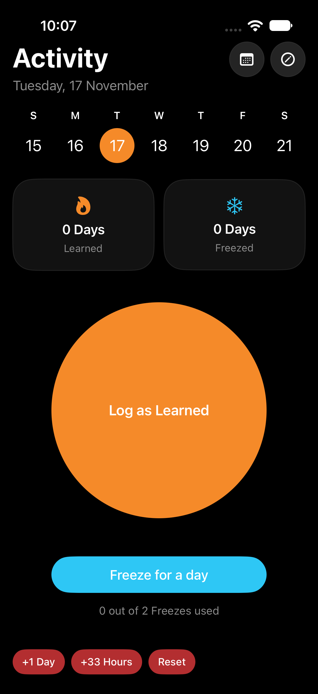
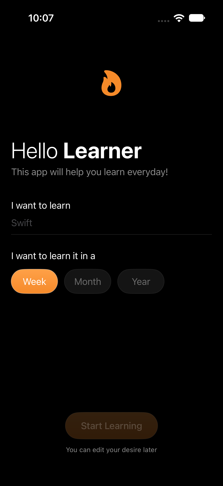
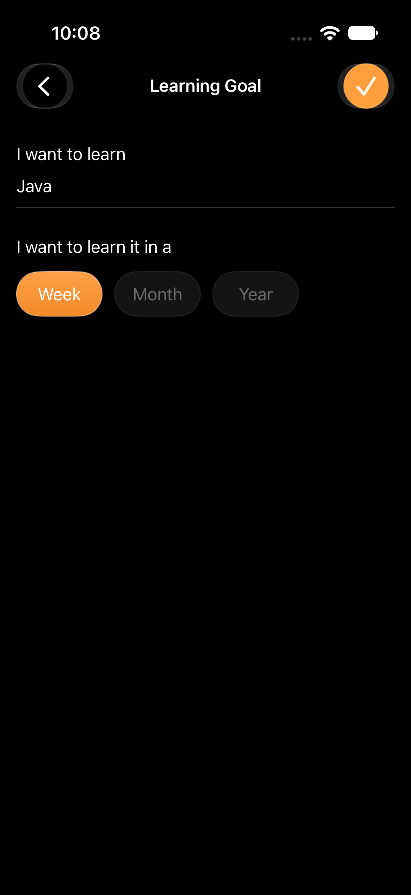
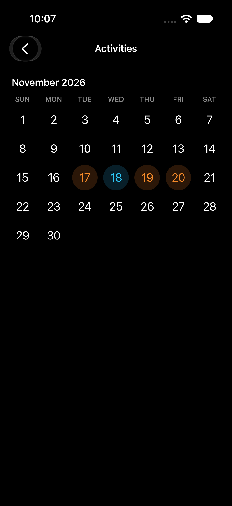

# Learning Journey 

An iOS app that helps you build a daily learning habit. Set a goal (what you want to learn and for how long), log each day you learn, and use Freezes to protect your streak when you can't.

## Main Features

- **Set a learning goal**: choose what you want to learn and the duration: Week, Month, or Year.
- **Log as Learned**: log your learning once per day to grow your streak.
- **Freeze a day**: protect your streak on days you can't learn. Freezes are limited by duration:
  - 2 per week
  - 8 per month
  - 96 per year
- **Weekly activity strip**: see the current week, with learned days in orange and frozen days in blue.
- **Stats cards**: track how many days you learned and how many you froze (shows "1 Day" or "2 Days" correctly).
- **Goal result**: a completed goal shows "Well done!". Missing a day without a Freeze shows "You didn't reach your goal this time."
- **Smart streak rules**:
  - Learned and Frozen days both count toward the goal.
  - The streak breaks after more than 32 hours without logging or freezing.
  - Buttons reset every day at 12 AM.
  - Updating the goal restarts the streak, after a confirmation popup.
- **Activities calendar**: a view-only calendar showing your full history month by month.
- **Local storage**: your progress is saved on the device.

## Screenshots

| Onboarding | Activity | Learning Goal | Calendar |
|---|---|---|---|
|  |  |  |  |

## Technologies Used

- **Swift** and **SwiftUI**
- **MVVM** architecture (Models, ViewModels, Views, plus a shared `LearningStore`)
- **Combine** (`ObservableObject`, `@Published`)
- **Codable** and **UserDefaults** for local storage
- **Xcode**, iOS 17+

## Project Structure

```
App/          App entry point
Models/       GoalDuration, LearningGoal, DayLog
Services/     StorageService
Store/        LearningStore (streak and freeze rules)
ViewModels/   Onboarding, Activity, GoalEdit, Calendar
Views/        Screens and reusable components
Support/      Theme, Strings, Calendar helper
```

## Author

Munira Alhajri
